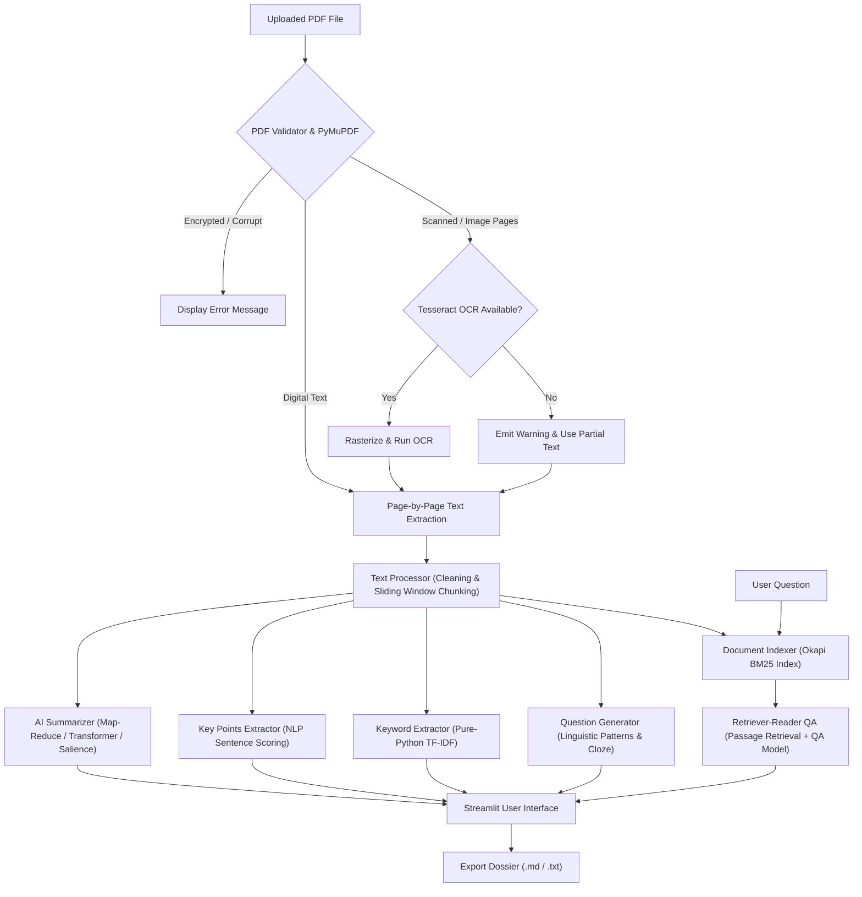

# AI PDF Summary Tool 📚

An intelligent Natural Language Processing (NLP) and Machine Learning application designed for students, teachers, and researchers to rapidly read, synthesize, revise, and query PDF documents.

---

## 🎓 Academic Project Abstract

Reading and synthesizing academic papers, technical documentation, and textbook chapters is a time-consuming task in modern education and scientific research. The **AI PDF Summary Tool** demonstrates a practical application of Artificial Intelligence and Natural Language Processing to automate document comprehension workflows. 

The system implements a multi-stage pipeline:
1. **Document Ingestion & Validation:** Validates PDF integrity and extracts digital text page-by-page using PyMuPDF, while automatically flagging scanned pages for Optical Character Recognition (OCR) via Tesseract.
2. **Text Normalization & Chunking:** Normalizes typographical irregularities and divides multi-page content into sentence-bounded sliding windows that respect transformer context windows.
3. **Multi-Length Abstractive & Extractive Summarization:** Generates Short, Medium, or Long summaries using pretrained Hugging Face Transformers (`sshleifer/distilbart-cnn-12-6` / `t5-small`) with hierarchical map-reduce synthesis and a fast NLP extractive fallback.
4. **Key Insights & Terminology:** Employs NLP sentence-salience scoring and pure-Python TF-IDF n-gram vectorization to extract categorized key takeaways (Core Concepts, Findings, Takeaways) and ranked domain keywords.
5. **Study Support & Document Grounded Q&A:** Formulates study questions with verified document answers and enables interactive natural language querying ("Ask the PDF") utilizing a Retriever-Reader architecture (Okapi BM25 ranking + extractive QA with confidence scores and page citations).

The entire application runs locally, ensuring student and researcher data remains private.

---

## 🏗️ Architecture & Workflow Diagram



---

## 💻 Technology Stack

- **User Interface:** Streamlit
- **PDF Extraction & Geometry:** PyMuPDF (`fitz`)
- **Pretrained AI Models:** Hugging Face Transformers (`sshleifer/distilbart-cnn-12-6`, `distilbert-base-cased-distilled-squad`, `t5-small`)
- **Deep Learning Framework:** PyTorch (`torch`)
- **Information Retrieval & NLP:** Okapi BM25, TF-IDF n-gram analysis, Regular Expression pattern engines
- **OCR Engine:** Tesseract OCR with `pytesseract`
- **Image Processing:** Pillow (`PIL`)
- **Testing Framework:** `pytest`

---

## ⚡ Key Features

### Phase 1 — Core Features
- **PDF Validation & Error Handling:** Validates `%PDF` magic headers, file size limits (up to 50 MB), and detects corrupted or password-protected files.
- **Page-by-Page Extraction:** Preserves page boundaries and collects document metadata (title, author, creation date, reading time).
- **Multi-Length Summaries:**
  - **Short:** Concise overview (~80-120 words).
  - **Medium:** Balanced executive summary (~200-350 words).
  - **Long:** Detailed breakdown (~400-600 words).
- **Map-Reduce for Long Documents:** Processes multi-page PDFs section-by-section and consolidates them into a unified summary.
- **Dual Export:** Download summaries and analysis dossiers in formatted Markdown (`.md`) or plain text (`.txt`).

### Phase 2 — Advanced Features
- **Key Points & Categorization:** Extracts salient sentences and groups them into:
  - 🎯 Core Concepts & Definitions
  - 📊 Key Findings & Evidence
  - 💡 Actionable Conclusions & Takeaways
- **TF-IDF Keyword Extraction:** Identifies unigrams and 2-word key phrases with normalized relevance scores and document frequencies.
- **Study & Revision Questions:** Automatically generates review questions categorized by type (Conceptual, Factual, Process) paired with grounded document answers.
- **Ask the PDF (Interactive Q&A):** Queries document passages using BM25 ranking, extracts precise answers, displays confidence scores, and cites source page numbers.
- **Scanned PDF Support:** Detects image-only pages and extracts text using Tesseract OCR.

---

## 🚀 Installation & Setup Guide

### 1. Prerequisites
- Python 3.10+ (tested on Python 3.10 – 3.13)
- Windows, macOS, or Linux

### 2. Clone the Repository
```bash
git clone https://github.com/your-username/AI-PDF-Summary-Tool.git
cd AI-PDF-Summary-Tool
```

### 3. Install Dependencies
```bash
pip install -r requirements.txt
```

### 4. (Optional) Install Tesseract OCR for Scanned PDFs
- **Windows:** Download the installer from the [UB-Mannheim Tesseract repository](https://github.com/UB-Mannheim/tesseract/wiki) and install to the default location (`C:\Program Files\Tesseract-OCR`).
- **Ubuntu/Debian:** `sudo apt-get install tesseract-ocr`
- **macOS:** `brew install tesseract`

*Note: The application functions normally on digital PDFs even if Tesseract is not installed.*

### 5. Run the Application
```bash
python -m streamlit run app.py
```
Or simply double-click / run [`run.bat`](file:///d:/AI/run.bat) on Windows.

Open your browser at `http://localhost:8501`.

---

## 🧪 Automated Testing

The project includes unit tests covering valid/corrupted PDFs, summarizer chunking, question answering, OCR fallbacks, and keyword extraction. Expensive model inferences are mocked for fast and deterministic test runs.

To run the test suite:
```bash
pytest tests/ -v
```

### Actual Test Results
```text
tests/test_document_qa.py::test_bm25_retrieval PASSED                    [  3%]
tests/test_document_qa.py::test_qa_answer_present PASSED                 [  7%]
tests/test_document_qa.py::test_qa_answer_absent PASSED                  [ 11%]
tests/test_document_qa.py::test_qa_with_mocked_neural_pipeline PASSED    [ 14%]
tests/test_document_qa.py::test_keyword_extraction PASSED                [ 18%]
tests/test_document_qa.py::test_key_points_extraction PASSED             [ 22%]
tests/test_document_qa.py::test_question_generation PASSED               [ 25%]
tests/test_ocr_engine.py::test_ocr_availability_check PASSED             [ 29%]
tests/test_ocr_engine.py::test_ocr_missing_dependency_raises_error PASSED [ 33%]
tests/test_ocr_engine.py::test_ocr_mocked_extraction PASSED              [ 37%]
tests/test_ocr_engine.py::test_get_tesseract_version_fallback PASSED     [ 40%]
tests/test_pdf_extractor.py::test_validate_valid_pdf PASSED              [ 44%]
tests/test_pdf_extractor.py::test_validate_empty_bytes PASSED            [ 48%]
tests/test_pdf_extractor.py::test_validate_corrupt_bytes PASSED          [ 51%]
tests/test_pdf_extractor.py::test_validate_corrupt_structure PASSED      [ 55%]
tests/test_pdf_extractor.py::test_extract_single_page_pdf PASSED         [ 59%]
tests/test_pdf_extractor.py::test_extract_multi_page_pdf PASSED          [ 62%]
tests/test_pdf_extractor.py::test_detect_scanned_page PASSED             [ 66%]
tests/test_summarizer.py::test_clean_text_hyphenation PASSED             [ 70%]
tests/test_summarizer.py::test_clean_text_whitespace PASSED              [ 74%]
tests/test_summarizer.py::test_split_into_sentences_abbreviations PASSED [ 77%]
tests/test_summarizer.py::test_chunk_text_preserves_sentences PASSED     [ 81%]
tests/test_summarizer.py::test_readability_stats PASSED                  [ 85%]
tests/test_summarizer.py::test_summarize_empty_text PASSED               [ 88%]
tests/test_summarizer.py::test_summarize_short_passthrough PASSED        [ 92%]
tests/test_summarizer.py::test_summarize_lengths_extractive_fallback PASSED [ 96%]
tests/test_summarizer.py::test_summarize_with_mocked_pipeline PASSED     [100%]

============================= 27 passed in 6.11s ==============================
```

---

## ⚠️ Known Limitations & Troubleshooting

1. **Scanned PDFs Without OCR:**
   - *Limitation:* If a PDF contains image scans and Tesseract is not installed, the tool will issue an alert and will not extract text from image-only pages.
   - *Solution:* Install Tesseract OCR using the instructions above, or input the binary path into the custom OCR field in the sidebar.
2. **Encrypted or Password-Protected PDFs:**
   - *Limitation:* Encrypted files cannot be parsed directly.
   - *Solution:* Remove the password from the PDF before uploading.
3. **Environment Security Policies (Windows Defender Application Control / WDAC):**
   - *Observation:* On Windows systems with Smart App Control or WDAC, certain unsigned `.pyd` native DLL extensions may be restricted by system policy.
   - *Design Choice:* The application incorporates a pure-Python Okapi BM25 retriever, pure-Python TF-IDF engine, and an extractive NLP summarizer. If native neural runtimes are blocked by OS policy, the application falls back automatically to its pure-Python engines without crashing.
4. **Hardware Acceleration:**
   - If an NVIDIA GPU with CUDA is present, models will leverage the GPU automatically. On standard CPUs, processing utilizes multi-core threads.

---

## 📂 Project Directory Structure

```text
AI-PDF-Summary-Tool/
├── app.py                      # Main Streamlit web application
├── requirements.txt            # Python dependencies
├── README.md                   # Project documentation & academic abstract
├── PROJECT_PROGRESS.md         # Detailed progress tracker & test execution log
├── CONTINUATION_PROMPT.md      # Copy-ready prompt for subsequent development
├── .gitignore                  # Git ignore definitions
├── utils/
│   ├── __init__.py             # Utilities exports
│   ├── pdf_extractor.py        # PDF validation, parsing & scanned page detection
│   ├── ocr_engine.py           # Tesseract OCR discovery, rasterization & fallback
│   ├── text_processor.py       # Cleaning, sentence splitting, chunking & metrics
│   ├── summarizer.py           # AI summarizer (DistilBART / T5 / Extractive fallback)
│   ├── key_points.py           # NLP sentence-salience ranking & categorization
│   ├── keyword_extractor.py    # Pure-Python TF-IDF unigram & bigram extraction
│   ├── question_generator.py   # Grounded revision questions with page citations
│   └── document_qa.py          # Okapi BM25 passage retrieval + extractive reader
└── tests/
    ├── __init__.py             # Test package initializer
    ├── test_pdf_extractor.py   # PDF validation & extraction unit tests
    ├── test_summarizer.py      # Chunking, length bounds & mocked pipeline tests
    ├── test_document_qa.py     # BM25 retrieval, QA present/absent & keywords tests
    └── test_ocr_engine.py      # OCR availability, error handling & mock tests
```

---

## 📜 License
This project is open-source under the Apache 2.0 License. Designed for academic and educational purposes.
